## Context

Cars that talk to each other can warn a driver before a crash they can't see yet. In real systems each car broadcasts a Basic Safety Message, in the style of SAE J2735, about 10 times a second: who it is, how fast it's going, and where it is. The physical layer here is modeled on IEEE 802.11p: a 10 MHz channel, OFDM, BPSK and a rate 1/2 convolutional code.

## My role

This was my final project for EE 4003, Communications Engineering Design, with my lab partner Jason Phan. We wrote the report together. I designed and wrote the transmitter, the receiver and the warning logic in MATLAB, and ran all five hardware tests. The sync chain extended my Lab 9 BPSK loopback; the project added OFDM channel estimation, MMSE equalization, the two-car decode and the warning logic.

## Approach

**One radio plays both cars.** The cars are simulated: one ADALM-PLUTO transmits Car 2's packet and then Car 1's packet on a loop, and a second Pluto records and decodes both, keeping the lowest-BER decode for each car. It is one transmitter and one receiver, not a radio in each car.

**The message.** Each car's payload is 10 bytes, 80 bits: vehicle ID, velocity, acceleration, position X and position Y. The rate 1/2 code with constraint length 7 and polynomials [171 133] turns it into 160 bits, padded to 192 to fill four OFDM symbols of 48 data subcarriers.

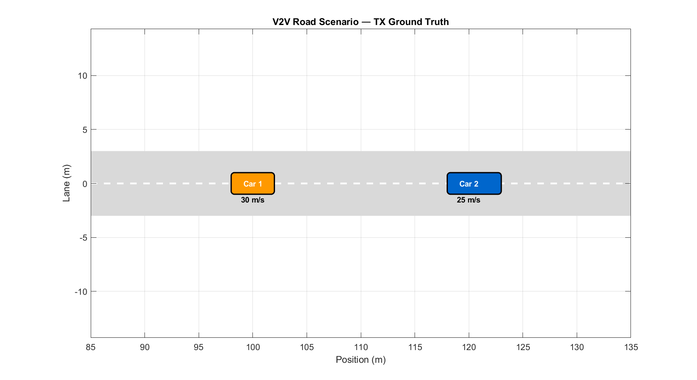

*Fig. 01 / Road scenario, Run 4.* The ground truth: what each car's message says before it goes on the air.

**The frame.** Every packet is a preamble (PRE) of 63 BPSK symbols at 16 samples per symbol with root-raised-cosine pulses, a 256-symbol training sequence (TRAIN), one OFDM preamble symbol, four OFDM data symbols, and a guard of zeros. The OFDM symbols use 52 subcarriers at 156.25 kHz spacing: 48 data and 4 pilots at plus and minus 7 and 21, with a 16-sample cyclic prefix (1.6 microseconds at 10 MHz).

**The receiver, in order.** All figures below are from Run 4: six inches apart, with a laptop lid between the radios.

1. **PRE detect.** Cross-correlate the received samples with the known BPSK preamble. One peak per packet gives coarse timing.

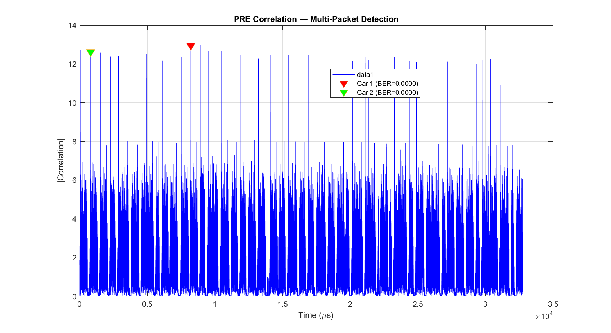

*Fig. 02 / PRE correlation, Run 4.* One sharp peak per packet across the recording; the marked peaks decoded with zero bit errors.

2. **Tau sweep.** Try each sampling phase from 0 to 15 (16 samples per symbol) and keep the one with the best score. The best tau was 0 in every run.

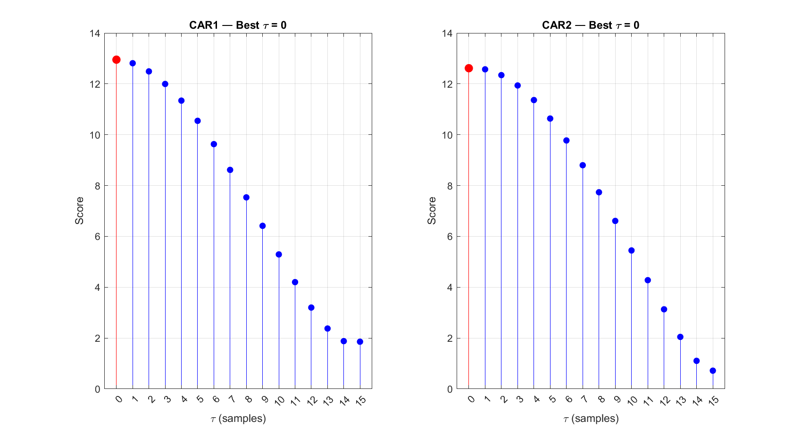

*Fig. 03 / Tau sweep, Run 4.* The score peaks at tau 0 for both cars.

3. **CFO.** Estimate the carrier frequency offset from the PRE and spin it out. The transmitter injects a 5000 Hz offset on purpose; the estimates came back between about minus 5100 and minus 5900 Hz, the extra being the two Plutos' own oscillator error. An estimate above 200 kHz is rejected as noise.

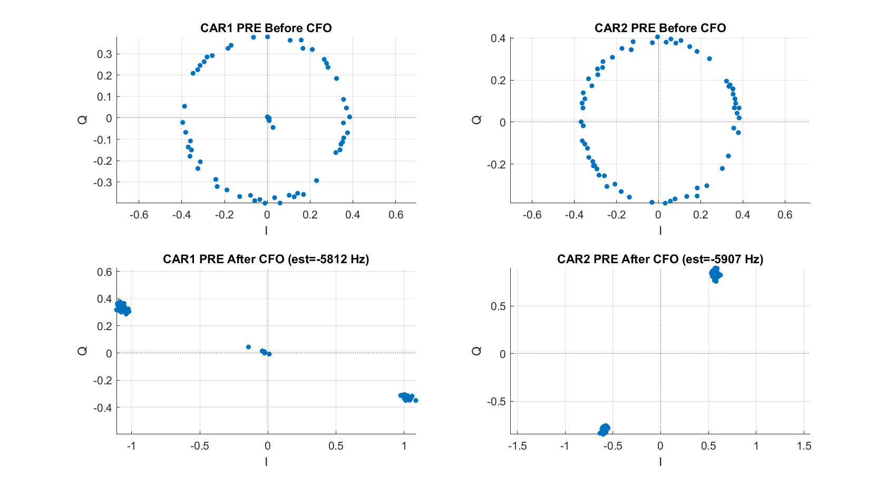

*Fig. 04 / CFO correction, Run 4.* Before, the offset smears the preamble into a ring; after removing about minus 5.8 to 5.9 kHz, two clusters.

4. **TRAIN fit.** The 256 known training symbols give the static phase offset and the linear drift, removed with a polynomial fit, and fix the polarity.

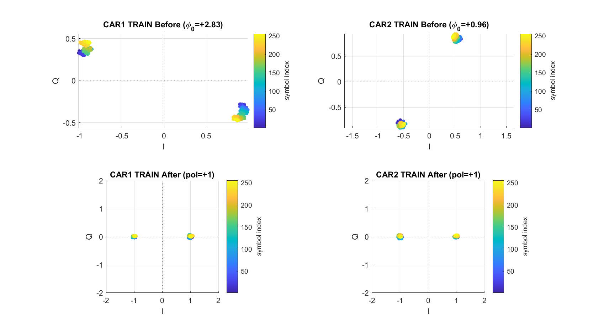

*Fig. 05 / TRAIN fit, Run 4.* The fit turns two rotated clusters into two clusters on the real axis.

5. **Decision-directed PLL.** A BPSK phase-locked loop with loop gain 0.001 and an 8-symbol burn-in tracks the residual phase on the PRE.

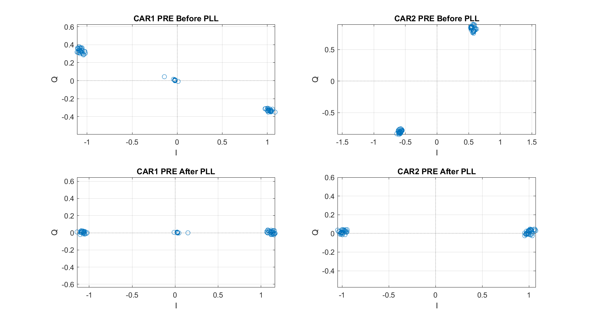

*Fig. 06 / Decision-directed PLL, Run 4.* The loop pulls the last of the phase error out of the preamble.

6. **OFDM demod and channel estimate.** Strip the 16-sample cyclic prefix, take the FFT, and divide the received OFDM preamble by the known one, subcarrier by subcarrier, to get the channel Hk.

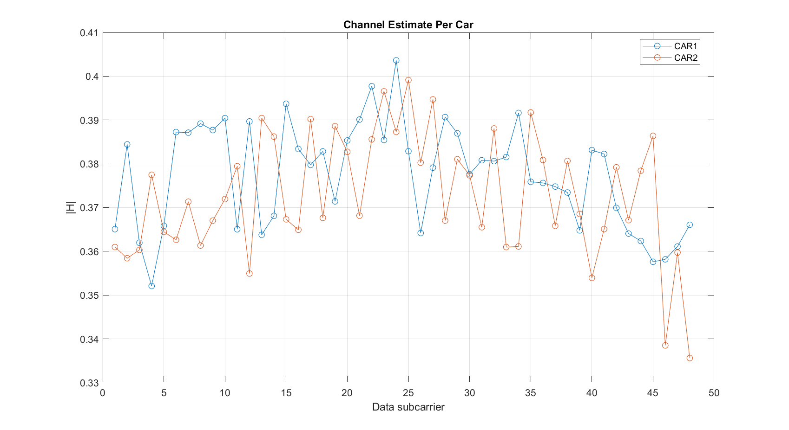

*Fig. 07 / Channel estimate, Run 4.* The channel magnitude per data subcarrier for both cars.

7. **MMSE equalize.** Correct each subcarrier using Hk and the noise variance, so weak subcarriers are not amplified into noise.

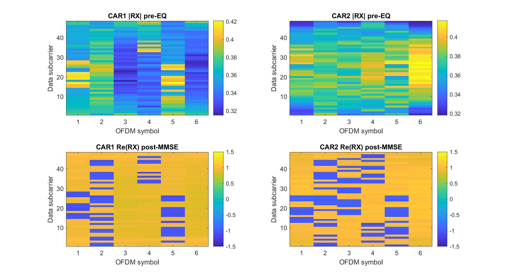

*Fig. 08 / OFDM grid, Run 4.* Before equalization the grid is uneven; after MMSE every subcarrier reads plus or minus one.

8. **Viterbi.** Decode the rate 1/2, constraint length 7 code with polynomials [171 133], the 802.11p code.

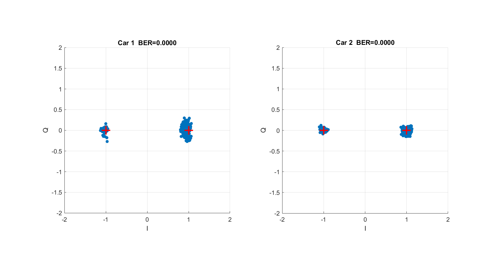

*Fig. 09 / BPSK constellation after equalization, Run 4.* What the Viterbi decoder is fed: two tight clusters per car, and zero bit errors after decoding.

9. **BSM.** Unpack the five fields from the 80-bit payload and compute time to collision.

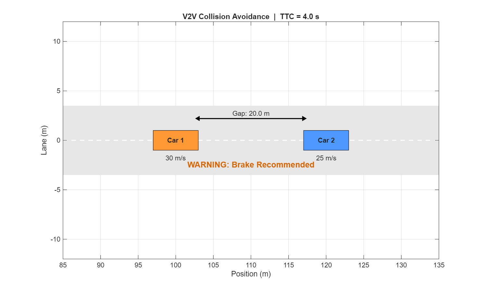

*Fig. 12 / Collision avoidance.* The decoded scenario: a 20.0 m gap closing at 5 m/s, 4.0 s to collision, and the brake warning.

**End at a decision.** Car 1 trails at 30 m/s, constant speed, at x = 100 m. Car 2 leads at 25 m/s, decelerating at minus 1 m/s², at x = 120 m. The gap is 20.0 m and the closing speed 5 m/s, so the time to collision is 4.0 s, below the 5.0 s threshold, and the receiver prints "WARNING: Brake Recommended". The decoded fields matched the transmitted ones exactly in every run.

## Hardware and the five runs

Two ADALM-PLUTO SDRs. The center frequency is 2.9 GHz, because the Pluto cannot reach the 5.9 GHz band real V2V uses. Sample rate 10 MHz, TX gain minus 10 dB, RX gain 40 dB, and each recording is 40 frames of 8192 samples, about 32.8 ms.

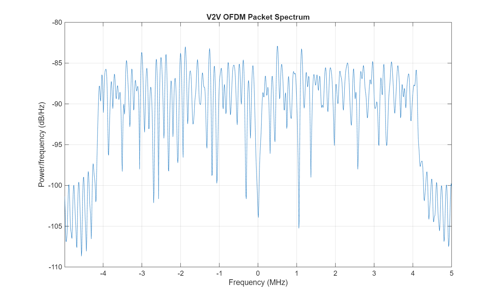

*TX spectrum / baseband.* About 8 MHz occupied: 52 subcarriers at 156.25 kHz.

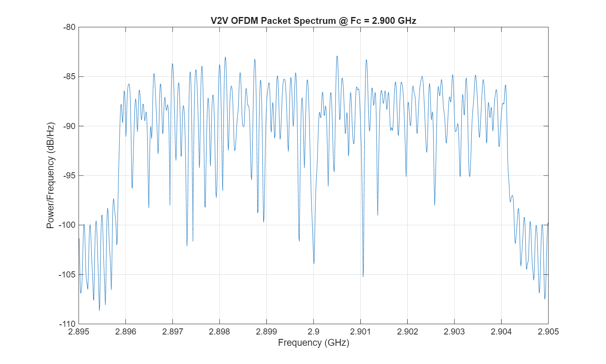

*TX spectrum / 2.9 GHz.* The 10 MHz band around 2.9 GHz.

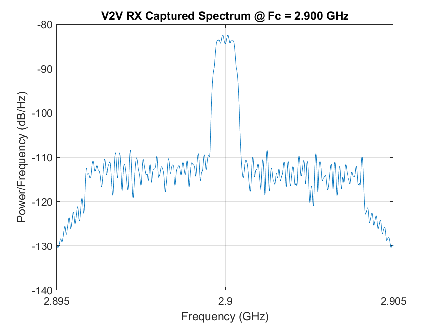

*RX spectrum / 2.9 GHz.* What the second Pluto recorded at 2.9 GHz.

Five over-the-air runs, all at BER 0.0000:

| Run | Distance | Obstruction | corrSNR Car 1 / Car 2 (dB) |
|---|---|---|---|
| 1 | 6 in | none | 8.2 / 8.2 |
| 2 | 3 in | none | 7.6 / 7.7 |
| 3 | 6 in | a hand | 7.5 / 7.6 |
| 4 | 6 in | a laptop lid | 7.5 / 7.6 |
| 5 | 6 in | around a corner, no line of sight | 7.3 / 7.1 |

For testing without radios, the same chain runs over a simulated Rician fading channel with three paths and 500 Hz of Doppler.

## Outcome

Five over-the-air runs, every one decoded with zero bit errors for both cars, through a hand, a laptop lid and around a corner, ending in the brake warning. Every stage saves its own figure, so when something breaks you can see exactly where.

## What I'd do next

Append tail bits so the Viterbi decoder's terminated mode matches the encoder, move from BPSK to QPSK on the data subcarriers, and record bit error rate against SNR over the air instead of only in simulation.
